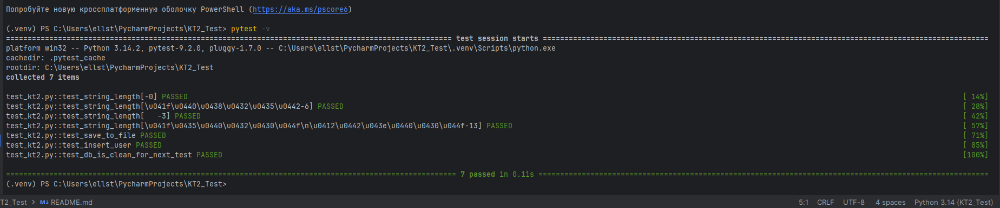

# КТ № 2. Проектирование тестовых наборов для заданного функционала или спецификации с использованием выбранной техники комбинирования тестов

В работе я реализовал три задачи с использованием фреймворка `pytest`.

Суть работы

1. Подсчет длины строки
Создана функция `get_string_length`. Для её проверки написаны тесты с использованием параметризации (`@pytest.mark.parametrize`). Покрыты случаи: пустая строка, строка из пробелов, обычный текст и многострочные строки.

2. Сохранение строки в файл
Создана функция `save_string_to_file`. Для теста использована встроенная фикстура `tmp_path`. Она изолирует файлы, создавая уникальную временную папку для каждого теста, и автоматически удаляет её после завершения.

3. База данных SQLite
В файле `conftest.py` создана фикстура `db_connection`. 
Она подключается к временной БД SQLite, создает таблицу `users` и передает соединение в тест через `yield`. После завершения каждого теста соединение закрывается, а база данных удаляется. Второй тест на БД проверяет, что данные из предыдущего теста не сохранились (полная изоляция).

Результат выполнения
Все 7 тестов успешно пройдены:

